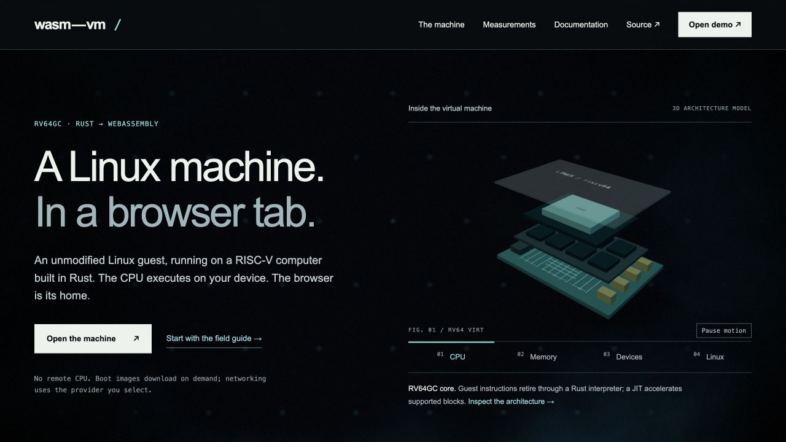

# Independent design critic — round 1

Scope: the landing page at `http://127.0.0.1:4186/landing.html`. The docs rewrite is in progress and is excluded from the completed-product claim in this round. Review is read-only for implementation; only this review record is written.

## Predictions recorded before runtime inspection

1. **Layer selection:** selecting Memory, Devices, or Linux will leave exactly one layer control pressed, visibly identify the selected layer in the 3D model, and replace the caption with the corresponding architectural fact and a working documentation link.
2. **Motion:** Pause motion will stop both automatic model motion and the retained background animation; Resume motion will restart them. The button will describe the available action and expose its state.
3. **Primary entry:** Open the machine and Open demo will lead to the actual demo `index.html`. Start with the field guide will open the quickstart reader route. No marketing illustration will be presented as executing guest output.
4. **Mobile:** at a 390 CSS-pixel viewport, the page will use its mobile layout, retain legible text and primary actions, fit within the viewport, and keep the layer controls reachable.
5. **Scope and evidence:** the Sail count and benchmark rows will link to the report/raw records supporting their stated scope; networking language will not promise that selected remote network providers are local or private.

Initial screenshots supplied for direct inspection: `01-home-desktop.jpg`, `01-home-mobile.jpg`; baseline: `00-current-home-desktop.jpg`. Findings and runtime observations follow after inspection.

## Verdict and independent score

**VERDICT: needs-evidence. Design score: 8 / 25 — does not pass.** Passing is at most 5 total, no category above 2, and no false claim or broken primary flow. The explanation quality of the model needs revision; the current preview also fails to initialize the actual workbench. This is a bounded landing-page review, not a task-status change and not approval of unfinished docs.

| Category (lower is better) | Score | Concrete evidence and demand |
| --- | ---: | --- |
| Generic composition | 1 | `01-home-desktop.jpg`: the large left headline/right model is a familiar hero composition, but the restrained rules, numbered architecture controls, and editorial capability rows are specific to the machine. The old rounded cards, gradient text, and fake terminal treatment are absent. Preserve this direction; make the right-hand diagram teach the named architecture rather than operate as another generic hardware render. |
| Empty language | 1 | `web/landing.html:14` names the Linux guest, RISC-V implementation, Rust and local CPU execution plainly. `web/landing.html:20` instead describes desktop/3D through “their own recorded, bounded acceptance criteria,” which gives the visitor little sense of the usable experience or its present limitation. Replace that sentence with concrete available display behavior and its experimental/software-rendering boundary, linked to the relevant record. |
| Decorative simulation | 3 | `01-home-desktop.jpg`, and current IAB captures of Memory/Devices/Linux: model labels are largely unreadable, and every selection keeps a similar motherboard silhouette. `web/hero-scene.js:95` draws the CPU label at 1.3×.28 scene units; RAM is smaller. `web/hero-scene.js:110` moves the selected slab only .13 scene units. Selection changes the caption correctly, but the image does not clearly identify the selected layer or the host→platform→Linux relationship. Add readable annotations, strong selected-layer emphasis, and an explicit relationship explanation. Real meshes alone do not resolve this category. |
| Evidence distance | 1 | `web/landing.html:16` links the 395-test baseline to a source report; `docs/level1-report.md:14` records 395/0 against Sail, and `:15` separately records native/wasm fingerprint equality. The workload and compute sections retain raw JSON/runner links (`web/landing.html:50`, `:81`) and preserve unsupported/unmeasured rows, verified against both JSON files and the rendered DOM. Scope is unusually candid. Reader deep links still need completion testing in the later docs round; this round does not count unfinished reader routing as an accomplished claim. |
| Craft defects | 2 | Actual IAB 390×844 layout is legible with document width 390; controls are 88.5×46.15 CSS px. The motion control is only 90.25×24 CSS px with 10 px text. At the workload table, the phone shows Environment/File read/File write and a clipped Stream header, with no visible swipe hint or named/focusable scrolling region. `web/marketing.css:2` sets `.bench-table{min-width:860px}` and `.bench-wrap{overflow-x:auto}`; `web/landing.html:34` gives the wrapper no label or tabindex. Add an explicit mobile exploration affordance and keyboard access; increase the motion target/text for comfortable touch use. The current preview's dynamic-module failure also blocks the primary-flow acceptance gate below. |

## Runtime predictions and observations

These predictions were written above before the IAB session was created. The session used only the in-app browser, briefly, without Chrome or builds. The temporary 390×844 viewport was reset, and the review tab was closed.

1. **Layer selection — partially HELD; visual explanation FAILED.** CPU→Memory→Devices→Linux each produced exactly one pressed control, a matching factual caption, and the intended `docs.html?page=...` destination. Memory described WebAssembly linear memory and the emulated MMU; Devices described interrupts/UART/virtio and explicit providers; Linux described kernel/userland as RISC-V binaries. In the scene, small slab movement and yaw changes did not make the selected layer obvious. The pressed controls and prose carry nearly all the explanatory work.
2. **Pause/resume — HELD.** On the Linux selection, Pause changed the label to Resume and `aria-pressed` to true; `machine-canvas.dataset.motion` became `paused`. Two full 1280×720 IAB screenshots captured several seconds apart were byte-identical, including the background. Resume restored Pause/false. This demonstrates actual stable motion, rather than relying solely on a dataset flag. The `web/landing.js` diff retains the shader source and adds shared motion/visibility controls.
3. **Primary entry — FAILED in the supplied preview; packaging evidence needed.** Open the machine navigated to `http://127.0.0.1:4186/index.html`, the actual workbench. It remained at “initializing…”/“loading tasks…”. The embedded button inserted `./index.html?embed=1&noAutoBoot#ide` with the title “wasm-vm guest console”; the frame displayed the actual OS launcher and the marketing status became “Demo session open”. Both sessions then failed the main dynamic import. Exact IAB console points: `2026-10-13T14:11:35.123Z` (embedded) and `2026-10-13T14:12:05.040Z` (full index), `TypeError: Failed to fetch dynamically imported module: http://127.0.0.1:4186/main.js`. Rechecking the log and full-page state reproduced the same error/incomplete initialization. The worker acknowledged the preview packaging gap and did not claim successful execution. Recheck against a runnable built distribution; this is not a request to alter emulator behavior.
4. **Mobile — HELD in actual browser; supplied artifact REJECTED.** IAB was explicitly set to 390×844 CSS px. The hero wrapped normally, all primary links remained visible, document scroll width was 390, and all architecture controls were reachable with 46.15 px height. `01-home-mobile.jpg` is 390×219 pixels and shows the content squeezed into approximately the left 120 pixels with blank space to the right. It does not represent the inspected phone layout and must be replaced with a fresh capture after viewport application/state read. This malformed artifact is a capture defect, not proof of a product reflow defect.
5. **Scope/evidence — HELD for landed source wording; reader routes NEED EVIDENCE.** The hero says “No remote CPU” and explicitly says boot images download and networking uses a selected provider (`web/landing.html:14`). `docs/deployment/network-providers.md:11` describes remote Tailscale control/DERP, `:19` configured WebSocket transport, and `:23` offline behavior; `web/index.html:1287` exposes those choices. The new hero does not promise no server/no network or conceal those providers. Workload JSON is `partial` dated 2026-09-01, with WebVM not run and almostnode partial; compute JSON is separately `partial` with the main interpreter not run. The page renders those boundaries instead of inventing results. The quickstart, architecture, report, storage and performance reader routes must be exercised in the later completed-docs review.

## Captured flow steps

1. Desktop landing hero — clear entry and concrete product positioning; selected-layer explanation is weak.
2. CPU/Memory/Devices/Linux selection — state and captions work; visual selection needs improvement.
3. Pause/resume — works for both model and retained backdrop; touch affordance could be larger.
4. Phone hero and capability list — legible reflow; valid 390×844 screenshot needs to be saved.
5. Phone embedded-session entry — honest unopened state; opens the real OS launcher, then hits the preview module failure.
6. Phone workload table — honest data/scope, but horizontal exploration and keyboard focus need an affordance.
7. Full workbench launch — correct destination, incomplete initialization; runnable preview proof required.

## Required next improvements

1. Make all four scene selections unmistakable and informative: readable layer identity, strong emphasis, and an explicit architecture relationship. Recheck the image in each selected state on desktop and mobile.
2. Package the local preview so the real full and embedded workbench initialize without module errors. A loaded iframe alone is insufficient.
3. Replace the invalid mobile artifact. Add a visible table-swipe cue plus a named keyboard-focusable scroll container, and make Pause/Resume comfortable to tap.
4. Replace the desktop/3D process language with concrete current behavior and its relevant limitation. Preserve benchmark scope, unchanged raw results, and the distinction between local CPU and remote network providers.

The docs corpus, reader searching/routing, products/security/roadmap pages, zero-WebGL fallback, screen-reader interpretation, and complete keyboard flow are reserved for later review. This record does not claim accessibility compliance or verified emulator behavior.

## Evidence identity

SHA-256 of the reviewed material before revision:

```text
0cdf1d36fa27630df8ba85f48e0f0814fc1caf989e387706f0121f3716b40f45  web/landing.html
cd05a66821394e93286b210f6224da86840ccaff15d5663c7ce6523e2ca8330e  web/marketing.css
68f194d2bfdb32bf917b9ad7194c542b34c659616c35e31d707effe386f0eb4a  web/landing-page.js
bc229830d612b96bd113ce26c0c552881c4e793f5a38c1993e344d4c3880fb0f  web/hero-scene.js
aac7e0bf506c7890b41c603fac81425479fb191151af5de011a4530942c43dc3  web/landing.js
bd2d35a68a59d13301987f98854f48b360ab3596c0309d4bdf9a3a61d16d48c4  web/landing-benchmarks.js
66597cf5f540ca3892631223828f88a0304f3f8e226852fbb636660a5fca0970  design/reviews/01-home-desktop.jpg
516064cd017ddaef2232c8493b54378f0bf179e464a9dffad378a79b864c3225  design/reviews/01-home-mobile.jpg
```




