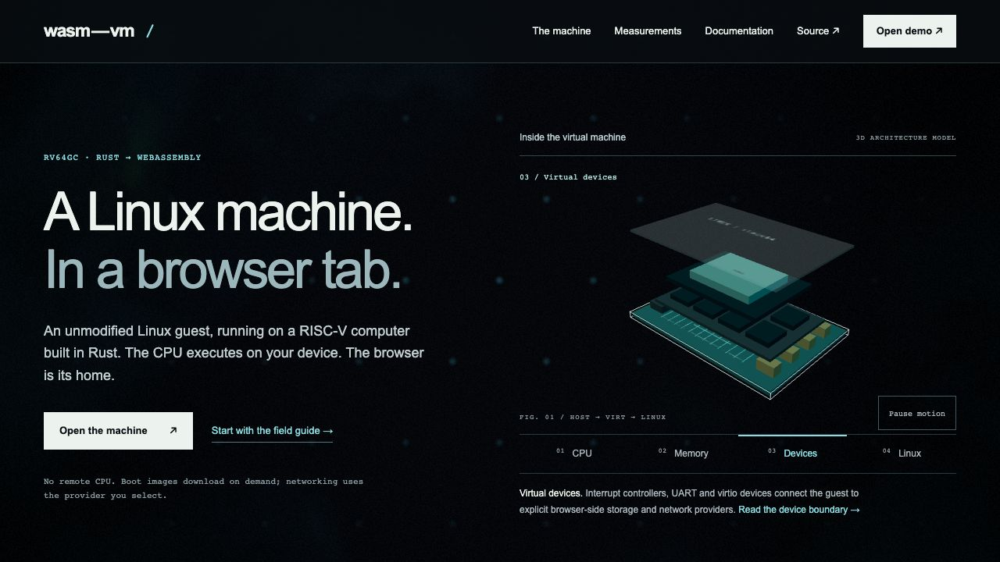
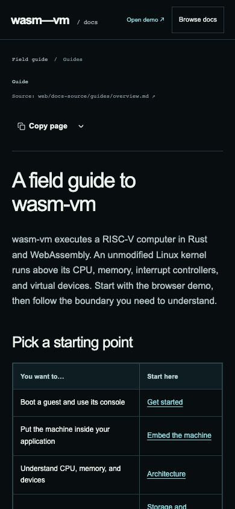

# Independent design critic — round 2

Scope: current landing page, products/security/work-market/roadmap pages, Docstream reader, six legacy public docs entries, and the complete migration inventory. Review uses the isolated server `http://127.0.0.1:4186/` with `review=2-final`. Implementation remains read-only. No emulator/GPU guest is booted by this review.

## Carry-forward from round 1

Held subject to unchanged dependency/evidence boundaries: clear local-CPU versus selected-network-provider wording; full benchmark row set and partial/unmeasured campaign scope; ordinary 390 CSS-pixel reflow; factual exclusive layer-control state; shared model/background pause behavior. The model emphasis, source preview packaging, phone controls and reader are changed and receive new checks.

## Predictions recorded before round-2 runtime inspection

1. **Selected-layer explanation:** Memory, Devices, and Linux each receive an obvious edge/position cue and readable identity matching the caption and exclusive selected control. The pause target is at least 44 CSS px high on a phone.
2. **Launch packaging:** the full and embedded workbench initialize without the earlier `main.js` dynamic-import error, and open usable guest-selection/demo controls. No iframe load label is accepted as sufficient evidence by itself.
3. **Reader routes:** quickstart from the landing page and all six legacy public doc URLs resolve to the intended document. Page navigation followed by Back restores the prior page. An unknown page presents a recoverable error.
4. **Search/filter/archive:** search can find technical content/path terms beyond titles, reference-subject filtering selects the named category while retaining guides, and the archive exposes individual reasons and source/replacement links for the complete inventory. Zero-result searches are unambiguous.
5. **Reading/portability:** table-of-contents links reach their headings; current-page copying and Markdown view expose the full document; the architecture demo distinguishes Linux and bare-metal paths, and Code view displays the actual file-backed source.
6. **Phone reader:** Browse docs opens a usable navigation/search menu; choosing a document closes it. Text and ordinary tables fit the viewport, and only actually wide tables display a scroll hint. Focus and motion controls remain usable.
7. **Truth and migration:** current machine behavior, dated evidence, and proposed product surfaces are explicit. All 1,533 baseline prose files are individually accounted for, retain original source bytes/digests, and rendered technical references retain code, tables, numbers, and full body content. Technical source links are pinned to the stated baseline revision.

Supplied current screenshots inspected: `02-home-desktop.jpg`, `02-home-mobile-model.jpg`, `02-docs-desktop.jpg`, `02-docs-mobile.jpg`, `02-products-desktop.jpg`. Runtime observations, bounded independent source checks, score and findings follow below.

## Round-2 verdict

**VERDICT: refuted. Score: 5 / 25.** The numeric score reaches the threshold, but the Markdown-view flow contradicts its visible promise and must be fixed before passing. This round is retained as a failed review; fixes receive a separate round-3 record.

| Category | Score | Evidence |
| --- | ---: | --- |
| Generic composition | 1 | The familiar split hero now has machine-specific selected-layer controls and explanatory captions. `critic-02-live-devices-desktop.jpg` shows a clear edge around the virtual-device board. The remaining pages use editorial rows with explicit scopes, rather than gradient-card grids. |
| Empty language | 0 | Current CPU, storage, network and display statements are concrete. Products, work market and roadmap state that their product layer is proposed; security distinguishes current IndexedDB/network behavior from proposed encrypted volumes. `critic-02-boundary-security.jpg` and the marketing-page steps in `critic-02-boundary-witness.md` show those labels. |
| Decorative simulation | 1 | The selected mesh now has an obvious outline, raised position, readable HTML identity and matching fact. The architecture demo separately distinguishes Linux/WasmLinux and bare-metal/WasmMachine entry points. The scene still uses a physical-board metaphor, but it explains the selected boundary and does not pretend to execute the guest. |
| Evidence distance | 1 | The reader makes original sources, complete Markdown and historical status accessible. Independent checks confirm 1,533 baseline prose blobs, 139 full technical bodies, 154 round-trippable pages after the graphics-guide addition, and 181 unchanged original code blocks. Current graphics scope explicitly says partial/offload-disabled; the old v5 decision is titled Historical graphics decision. The actual frozen runtime is not newly verified by publishing its report. |
| Craft defects | 2 | Phone layouts fit 390 px and the ordinary overview table fits 348 px without a false scroll hint. Search, filters, archive, legacy routes, menu and errors work. However, the actual View as Markdown action opens a download instead of its promised plain-text view. Two RISCOF reference labels also inherit the same template title, and the shader reference simply says Standard; precise publication titles would improve navigation. |

## Finding requiring a fix

- **Markdown view — FAILED.** Prediction: View as Markdown will expose the current page as plain text. Actual menu text is “View as Markdown / Open the page as plain text”; clicking it opens an ephemeral new target that closes as a download. Both `http://127.0.0.1:4186/docs-content/overview.md` and production-layout `:4188/docs-content/overview.md` return HTTP 200 with `Content-Type: application/octet-stream`. The exact observed point is `critic-02-final-controls-witness.md`, `actual page menu`, 2026-10-13T15:22:24.366Z, followed by `Target page, context or browser has been closed`. The installed `PageActions.js:57` uses the supplied `markdownUrl` as a direct link. Demand: use Docstream's documented plain-text Blob view by omitting that prop, or serve an inline plain-text response, while keeping a clearly labeled Markdown download/source link.
- **Reference labels — improvement requested.** The reader DOM includes two identical “Name of the Plugin. All entries are case sensitive. Including the name.” labels and a “Standard” label. These correspond to `compliance/spike/README.md`, `compliance/wasmvm/README.md` and the shader standard reference. Use precise source-aware publication titles without changing the original source body.

## Predictions resolved

1. **Layer explanation and phone pause — HELD.** CPU, Memory, Devices and Linux expose exclusive pressed state, matching annotations and captions. The actual Devices mesh edge is visible in the owned-browser screenshot. Phone width and document width are both 390; pause height is 44 CSS px (`critic-02-launch-witness.md`, phone model).
2. **Primary packaging — HELD at the production boundary.** The embedded source launcher reaches core 0.0.1 and enabled guest choices with no module error. The full production workbench at `:4188/app.html#ide` reaches core 0.0.1, `crossOriginIsolated: true`, and actual `wvmDemo.exec`/`runBusybox` functions. The Docs tab loads the new reader while retaining the parent bridge (`critic-02-boundary-witness.md`). No GPU guest was booted. The initial source-headerless version timeout was a preview COI/service-worker boundary, not an emulator implementation finding.
3. **Reader navigation — HELD.** Overview→quickstart→Back returns the expected document; all six legacy entries resolve their intended guide; an unknown page presents a recovery link that returns to the field guide (`critic-02-reader-witness.md`).
4. **Search/filter/archive — HELD.** Content search copy-on-write returns exactly five independently predicted pages. Networking filtering retains guides and the six matching references. An impossible search returns zero. Archive search tasks/QUEUE.md returns the exact preserved record and its pinned baseline URL.
5. **Contents/copy/Code — HELD except Markdown view.** The contents link and heading both use product-direction. The heading is fully visible in `critic-02-failure-table-of-contents.jpg`; my first script incorrectly demanded that a final section align within 160 px of the top, despite bottom-clamped scrolling. Copy page as Markdown copies exactly the current overview, 2,551 bytes, SHA-256 `777ff354c4641d7d6a07b4394bf73497daf7d21ce918018610a395223561deb8`. View Code expands the single-file panel; copying its file yields exactly the actual architecture-demo.jsx bytes with trailing-newline normalization, length 1,499 (`critic-02-boundary-witness.md`). The earlier Copy page / Code-tab locator failures were incorrect harness labels, not product defects.
6. **Phone reader — HELD.** Viewport/document width 390; small overview table client/scroll width 348 and hint hidden. Browse docs opens the menu; selecting quickstart closes it. The independently captured screenshot is `critic-02-reader-mobile-live.jpg`.
7. **Migration and truth — HELD.** Read-only git-cat-file comparison checked all 1,533 original prose blobs against the baseline revision, current source files and ledger digests, with zero drift. All 139 published full bodies retained original content aside from titles/frontmatter, source notices and resolved links. Docstream parsing/serialization checks passed; all 181 original code blocks matched. The current 1.8.0 package also matches the live [official latest registry response](https://registry.npmjs.org/@brett_lamy/docstream/latest). Scope notices distinguish historical graphics/container/rr records and proposed product work. The coverage source-label mismatch identified early in this round was fixed and directly rechecked against its actual Markdown URL.

## Evidence and limits

Independent owned Chrome runs used temporary profiles and closed/removed them afterward. They did not attach to, navigate or terminate the existing graphics Chrome process. Browser records are `critic-02-launch-witness.md`, `critic-02-reader-witness.md`, `critic-02-final-controls-witness.md` and `critic-02-boundary-witness.md`. The original script errors remain visible in these records and are interpreted above instead of being hidden.

The BF-cache-specific Back/control branch still needs the final narrow recheck: the navigation reached the restored landing page, but Playwright waited for a DOMContentLoaded event that BF-cache restoration does not emit. That harness wait is not a product refutation. Complete guest execution, renderer performance and graphics correctness remain outside this website review.

