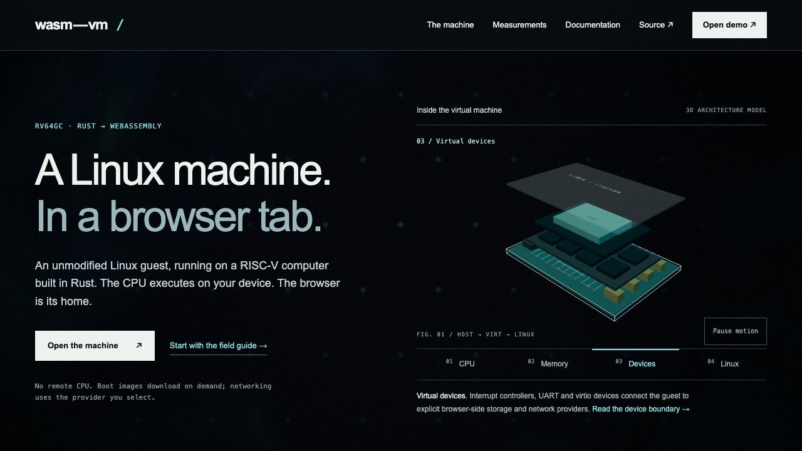
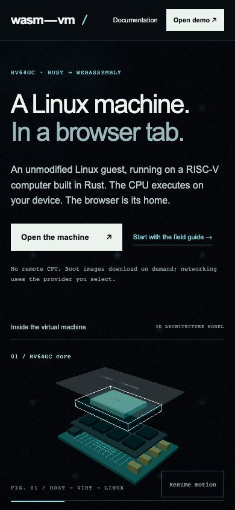
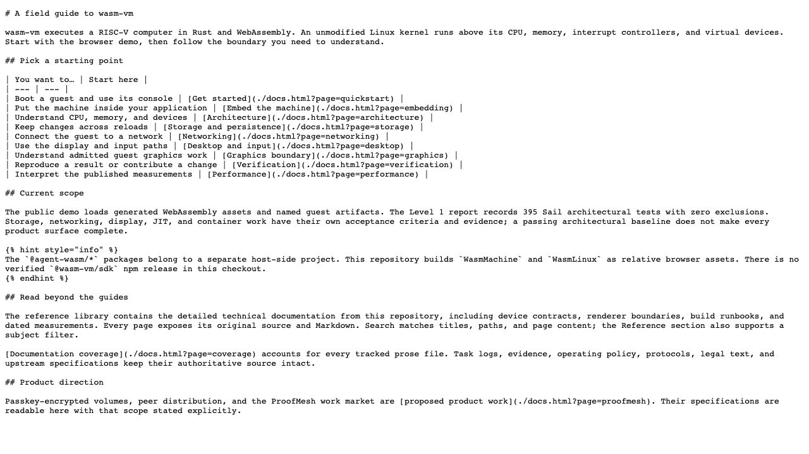

# Independent design critic — round 3

This is the narrow follow-up to round 2's actual Markdown-view failure. The original failed round and harness diagnostics remain in critic-02.md and its witnesses. Unchanged HELD source/body, benchmark, scope, navigation, search/filter, legacy-route, phone and Code-byte findings carry forward.

## Predictions before the final runtime check

1. **Markdown view:** the corrected View as Markdown action opens a text/plain Blob page containing the entire current Markdown. The separate Download Markdown action remains explicit.
2. **Labels/count:** the RISCOF and shader reference titles identify their source; the archive badge/count accounts for 1,995 individual baseline records, including the unchanged 1,533 prose files and added preserved legal/spec/fixture records.
3. **Back lifecycle:** landing→quickstart→Back returns a usable scene; selecting Devices updates the outline, selected annotation and caption. Where BF-cache restoration occurs, its pageshow event reports persisted true rather than a freshly reloaded document.
4. **Reduced motion/mobile budget:** a fresh 390×844 page under prefers-reduced-motion starts with both canvases paused and a Resume label; independent captures stay stable. The foreground/backdrop backing-store ratios respect their mobile caps. This is a rendering-budget check, not a performance or guest-GPU claim.
5. **No-WebGL fallback:** with WebGL deliberately disabled, the textual architecture overview appears; canvas/motion controls are hidden; selecting Memory still changes the exclusive control, factual caption and link. Expected Three initialization errors in this explicitly disabled context do not count as normal-path errors.

The checks use only owned isolated Chrome processes/profiles. The normal production route is the local assembly at http://127.0.0.1:4188/, which sends the real Cloudflare COOP/COEP contract. No existing graphics browser is attached or terminated, and no GPU guest is booted.

## Final verdict and score

**VERDICT: verified — website design/reader review. Score: 4 / 25, passing.** No category exceeds 2. The earlier view-flow contradiction is fixed. This verdict does not change repository task status, prove guest graphics or performance, or constitute a live-deployment check.

| Category | Score | Independent evidence |
| --- | ---: | --- |
| Generic composition | 1 | `critic-03-back-devices.jpg`: a familiar split hero is made specific by the actual machine layers, selected board outline, explicit RV64GC/Rust/WebAssembly context and real workbench entry. Editorial proposal pages avoid generic gradient-card grids and name their contracts. |
| Empty language | 0 | Marketing states local CPU execution and selected external network providers. Product/security/market/roadmap pages label current versus proposed behavior. Display copy now states partial guest GPU offload and disabled default production acceleration. Native/reference scope retains actual numbers and limits instead of vague superiority claims. |
| Decorative simulation | 1 | The selected physical slab has a visible mesh edge, readable annotation, exclusive control and specific architectural caption. `critic-03-back-devices.jpg` makes Devices identifiable. The file-backed architecture example explains Linux and bare-metal ownership separately; copied code matched its actual 1,499-byte source. The cutaway remains an illustration, and the docs say so explicitly. |
| Evidence distance | 1 | The original sources, report scope and downloadable/viewable Markdown are reachable. Final independent checks cover 1,989 immutable non-obsolete baseline records, all 139 complete published reference bodies, 154 lossless round trips and 181 unchanged original code blocks. Report publication remains distinct from current verification. Evidence still requires following the original task/run boundary, which is candidly stated. |
| Craft defects | 1 | Phone pages fit 390 px; ordinary reader tables fit without false hints; controls and reduced-motion behavior work. `critic-03-reader-desktop.jpg` shows clear reading hierarchy and corrected source-aware titles. Small provenance/annotation text remains a modest readability cost. Optional improvement: increase the mobile provenance text/link target so inspecting the original source is as comfortable as using the Copy/Download controls. This does not block acceptance. |

## Narrow predictions resolved

1. **Markdown view — HELD.** `critic-03-runtime-witness.md`, fixed Markdown view: a Blob page opens and its complete body matches the current published Markdown, length 2,549 rendered characters. `critic-03-markdown-view.jpg` is the actual plain-text view. The separate action visibly says Download Markdown ↓. The HTTP Markdown download remains a download; View is now handled by Docstream's plain-text Blob path.
2. **Labels/count — HELD.** The recorded sidebar contains RISCOF Spike reference plugin, RISCOF wasm-vm plugin and Standard VirGL shader bindings. Archive ledger displays 1,995. Final counts are 1,533 baseline prose files, 456 additional preserved legal/spec/fixture records and six obsolete HTML entries with replacements; 154 reader pages comprise 15 authored guides and 139 full references. Dispositions total 110 rewritten publications, 1,879 preserved records and six obsolete entries. The original 1,533-prose claim is not inflated into a claim of 1,995 reader pages.
3. **Back lifecycle — HELD under actual BF-cache.** The observer records pageshow/persisted=false, pagehide/persisted=true, then pageshow/persisted=true. After landing→quickstart→Back, Devices changes the annotation to 03 / Virtual devices, updates the fact/link and renders the selected outline. The final wait used navigation commit rather than demanding a DOMContentLoaded event from a cached restored document. See `critic-03-back-devices.jpg` and the Back Devices witness step.
4. **Reduced motion and phone budget — HELD.** Fresh 390×844 page reports foreground/background paused and Resume motion. Two captures are byte-identical. Backing-store/CSS-width ratios are 1 for the foreground and approximately 0.7487 for the background, within the mobile caps; the foreground records 52 draw calls. Document width is 390. These observations establish bounded rendering and motion behavior, not frame-rate or guest-GPU performance. See `critic-03-reduced-mobile.jpg`.
5. **No-WebGL fallback — HELD.** With WebGL intentionally disabled, the textual Architecture overview appears, canvas and motion have computed display:none, and Memory selection updates its annotation, exclusive pressed state, MMU/RAM caption and documentation link. Expected Three context-creation errors are tagged disabledWebGL=true in the witness. Normal round-3 paths record no console errors. See `critic-03-no-webgl.jpg`.

## Carried-forward completed flow checks

1. Desktop/mobile landing and all layer controls — healthy after the actual emphasis revision.
2. Full and embedded entry — usable actual workbench/launcher; production layout reaches core 0.0.1 under the real isolation headers. GPU guest execution is excluded.
3. Overview→quickstart→Back, all six legacy entries and unknown-page recovery — healthy.
4. Content search, reference-subject filter, zero results and archive source lookup — healthy.
5. Contents anchors, exact page copy, corrected Markdown view and actual file-backed Code view — healthy; original failed harness assumptions remain documented in round 2.
6. Phone menu/table reflow, pause/reduced motion and no-WebGL fallback — healthy within the recorded viewports.
7. Products/security/work-market/roadmap and current-versus-historical graphics boundaries — truthful and readable.

## Final source sufficiency check

The immutable-record check read baseline Git blobs directly and compared SHA-256 plus current source bytes for all 1,989 non-obsolete records: no drift. Every published reference retains its full original body after normalizing only resolved link destinations and titled fence metadata; all 139 bodies match. Separate AST comparison confirms all 181 original command/code blocks byte-for-byte, so fence-label normalization cannot conceal changed commands. All 154 pages parse and serialize losslessly. The initial conservative body check flagged 23 newly titled fences; normalizing their headers resolved those harness-only differences while the independent code-byte check remained exact.

New storage/quickstart detail covers local chunked-image availability, single-writer/read-only Web Lock behavior and typed snapshot cold-boot fallback. Historical source originals and frozen numerical records remain intact. Current graphics documentation distinguishes host Three.js illustration, guest CPU display upload, partial guest VirGL offload and separately verified slices; historical v5 limits are visibly historical.

## Final artifact identity

```text
1d4a8a917af0c1def463cb22c5ec82a11de03195c417ebfd1f2041782f6418a2  web/landing.html
c705c4904caa2eb9ae8ced4d7868d2a0aefd075caba8a2ab7eca23ba8a36fb0c  web/landing-page.js
129315f0c4abec4e9d95cbea874ee9e101b5a345ad18647b5dcdfeba94d7fc5d  web/hero-scene.js
aac7e0bf506c7890b41c603fac81425479fb191151af5de011a4530942c43dc3  web/landing.js
30ffb8380badcde20718b0e36476e9d80a9f9df9bafafa4b444c37c660e26223  web/docs-src/app.jsx
96d31ffb337e3404ef2f5f405ebdc03b5da48e222e1e8f926f0dbae9605bbd82  web/docs.css
e46ce185876759b20d48e4a0622a9d972df8c4b766ac3af995ddc09037fc10fa  web/docs-content/catalog.json
454f371c7d7e8fc1ec364351fcd0174a1a0d8c02d8adf8c82ff50223df78e1f7  design/documentation-migration.json
3658a144d737450a899ec2c395f7a8dc1eb4a0f75c8520d2ad352764bd50d16e  design/reviews/critic-03-runtime-witness.md
```

The reviewed local assembly reuses the isolated checkout's verified-base wasm rather than a new Rust build. The owned browser profiles were closed/removed. Source/body, UI, packaging and lifecycle findings are the scope of this record; emulator correctness, renderer qualification, actual guest performance and deployed Cloudflare state remain under their separate evidence boundaries.






