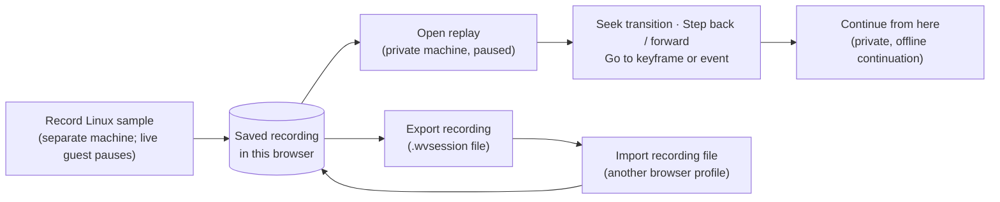
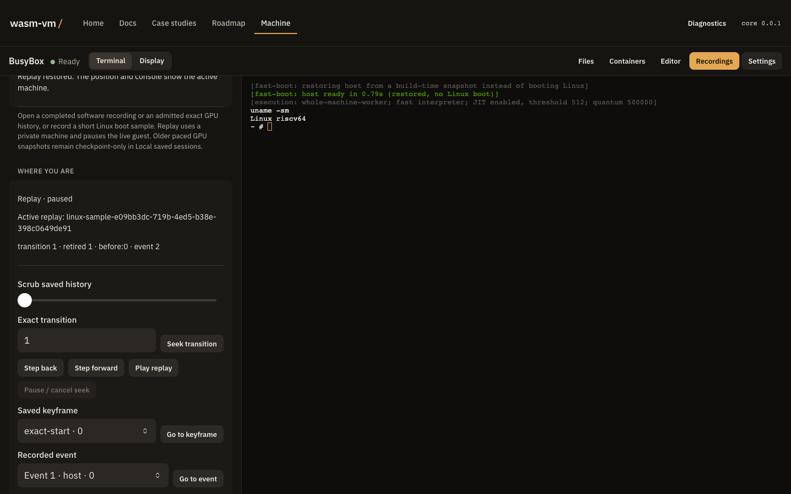

# Record, rewind, and branch

The [machine](./app.html#ide) keeps VM recordings locally in your browser. Open **Recordings** (on the workspace bar, under **Tools** on a phone, or **Recordings and time travel** on the first view before a guest starts). Its **Replay** tab selects a finished recording, shows its exact position, rewinds execution and continues in a separate branch; its **Checkpoints** tab keeps explicit restore points (see [Storage and persistence](./docs.html?page=storage)). The current integration covers software Linux and bounded accelerated guests. Full Omarchy cold-boot qualification and the original two-profile performance campaign were deferred; no desktop-wide or numeric latency guarantee follows from these functional checks.

 Every control in the pane operates the page's own timeline controller, so its checks and messages are the ones described below.

## Start with a real recording

Choose **Record Linux sample** for a short Linux execution excerpt, or **Record file example** for a Linux guest that changes a real file. These use a separate machine and pause the live guest. **Stop recording** ends the sample early and saves the completed prefix; the finished recording then opens. The short boot sample ends before external disk or network requests; it does not claim to capture your existing desktop or its live connections.

Recordings begin where capture starts. A saved checkpoint restores one point; a finished recording also contains the delivered input, device completions, time, entropy and applicable network/GPU results needed for exact execution between points. The integration checks include a full Alpine software session with real serial input, file changes and a witnessed local HTTP exchange, plus physical GPU result and paged-history fixtures. The small GPU fixture is an RV64 device workload, not a Linux/Mesa desktop.

## Move through history

1. Choose it under **Saved recording** and choose **Open replay**. Selecting a recording alone leaves the active machine in place.
2. Type an **Exact transition** and choose **Seek transition** (or press Enter), drag **Scrub saved history**, or pick a **Saved keyframe** or **Recorded event** and choose **Go to keyframe** / **Go to event**. The pending target is a preview until restoration finishes.
3. **Step back** or **Step forward**, or **Play replay** and **Pause / cancel seek**. The visible position, serial console and state digest refer to the same restored private machine. An exact position includes transition, retired instructions, event sequence and phase; a transition alone is a convenient navigation target.
4. Reload the page, choose the same local session and open it again. Its committed history survives the reload. A failed or cancelled save preserves the last committed prefix.

Replay consumes saved bytes and does not reopen the recorded network connection. A compatible exact GPU history also restores guest-visible GPU results and its physical canvas. Older paced GPU histories remain checkpoint-only under **Checkpoints**. Compatibility checks run before replay; an incompatible build, device profile or missing ancestor stays visibly unavailable.

## Continue from the past

Choose **Continue from here** at a restored point, then **Run continuation**, type into **Serial input** and **Send input + Enter**, and **Save continuation** or **Discard unsaved continuation**. The continuation gets private input and disk state; changing a file in that child does not rewrite its parent or siblings. Historical connections stay offline in a branch; **Go live** refuses to reuse a recorded connection. Keep the parent if you want to compare outcomes, and name the child so you can reopen it later.

## Transfer a recording

Open a finished recording and choose **Export recording** (it downloads a `.wvsession` file; nothing is uploaded), then use **Import recording file** in another browser profile. **Cancel local transfer** stops an export or import in progress, and **Delete local recording** removes the selected recording from this browser. The `.wvsession` archive includes its authenticated local closure, including required base bytes; replay does not need the exporter's image cache. Imports validate the complete archive before publication. Unsupported or corrupt files leave the existing library and active machine intact.

The installed runtime must match the recording's identity, and accelerated recordings also need a compatible physical GPU profile. This is an installed-build transfer format, not a promise that every historical recording runs after a runtime update. Export includes guest memory, file changes and recorded input/results, so share it with the same care as the guest itself.

## Manage local history

Storage is scoped to this browser origin and profile. **Checkpoints → Storage** shows usage; **Limits and cleanup** sets retention limits, requests persistent storage and cleans up unreachable data. Deleting a session reclaims only unshared data; another session's shared ancestors remain available. A storage-limit or recovery message identifies the failed operation instead of inventing a completed history. See [Storage and persistence](./docs.html?page=storage) for checkpoint controls and quota recovery.

## Reproduce the integration

`make verify-E9-T24` records the bounded clean-head integration, including independent byte/RAM/file oracles, fresh-profile UI transfer, exact seeking and replay with zero egress. The task's verification log carries the worker report and fresh Daybreak verdict. Prior recovery evidence in E9-T23 covers crashes, cancellation, quota, collection and physical GPU context loss. These receipts are functional evidence; they do not establish the deferred original-cold or performance claims.

## Current references

These describe the shipped recording format at revision `c396efe` (the PR 626 stack), separately from the pinned migration inventory:

- [Session replay](./docs.html?page=current-docs-design-session-replay): the full-system replay contract, exact positions and ownership
- [Session format](./docs.html?page=current-docs-design-session-format): session metadata format v1 and its compatibility rules
- [Session store](./docs.html?page=current-docs-design-session-store): atomic local storage, commits and retention
- [GPU history reader](./docs.html?page=current-docs-design-session-gpu-history-reader): bounded, authenticated GPU history reads
