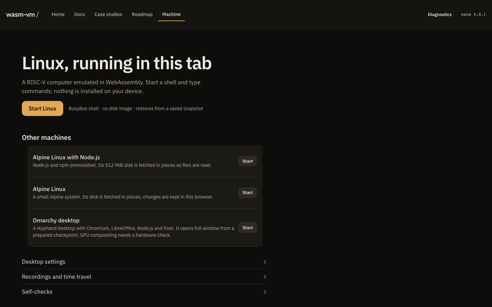
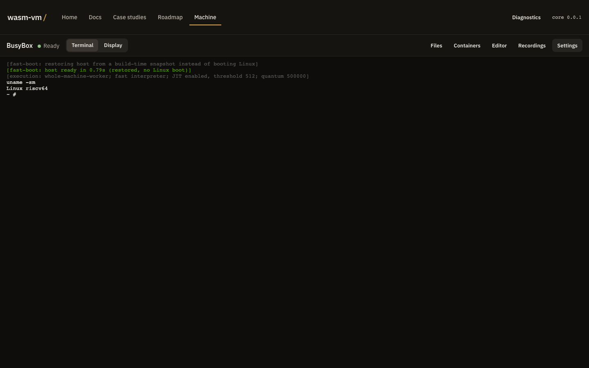

# Boot your first guest

Open the [machine](./index.html#ide) and choose **Start Linux**. It starts a BusyBox shell from a saved snapshot, with no disk image to download. Everything runs in this browser tab; nothing is installed on your device.

 The first view has one recommended start. Alpine, Alpine with Node.js and the Omarchy desktop are listed under **Other machines**; desktop graphics, recordings and self-checks stay closed until you open them.

## Your first session



**Choose Start Linux.** The status line shows loading and restoring progress; the loader checks each downloaded artifact against its SHA-256 digest before the guest uses it.


**Type in the terminal.** When the workspace shows **Ready**, click or tap the terminal and type a command, for example `uname -a` or `ls /`, then press Enter. What you type goes to the guest's shell. The host can also print its own status or error lines in the terminal, such as startup progress, a full-storage pause or a stopped machine.

 The terminal is the main view. **Display** switches to the guest's screen when a graphical guest draws one.


**Open tools when you need them.** On a desktop the workspace bar has **Files**, **Containers**, **Editor**, **Recordings** and **Settings**; on a phone they are under **Tools**, each opening full screen with a **Back to terminal** button.

- **Files** browses the guest's files and opens them in the **Editor**; you can also drop files onto it to copy them into the guest.
- **Containers** needs an Alpine guest that includes the `wvrun` runtime. BusyBox cannot run containers, and the pane says so.
- **Recordings** records and replays the machine, and keeps saved checkpoints. See [Record, rewind, and branch](./docs.html?page=time-travel).
- **Settings** holds keyboard capture (**Send keys to the guest**, **Release held keys**), **Pointer mode**, **Clear the screen**, the **Sound** state and the **Network** provider.



## Other machines

Each one starts from **Other machines** on the first view and replaces the running guest.

| Machine | What it is | What it downloads |
| --- | --- | --- |
| Alpine Linux with Node.js | Alpine with Node.js and npm installed | A 512 MiB disk, fetched in pieces as files are read |
| Alpine Linux | A small Alpine system; your changes are kept in this browser | Its disk, fetched in pieces |
| Omarchy desktop | Hyprland with Chromium, LibreOffice, Node.js and Foot, full window | A prepared checkpoint; the 4 GiB desktop image streams in pieces. Read [guest graphics](./docs.html?page=graphics) first |

**Desktop settings → Desktop graphics** chooses **GPU** (WebGL after a hardware check) or **Software** for the Omarchy desktop only.

You can also link straight to a machine: `index.html?guest=busybox#ide` in the source tree, `app.html?guest=busybox#ide` on the published site (`busybox`, `alpine`, `node-alpine` or `omarchy`).

## Build and serve it yourself

```sh title="Build the browser demo"
make web-build
make web-serve
```

`make web-build` builds the generated wasm module, installs the pinned browser packages, builds the shared interface and this documentation reader, and copies the guest ELF fixtures. `make web-serve` serves `web/` on port 8080. In the source tree `/` is the machine and `/landing.html` the homepage; the published site moves the machine to `/app.html` and puts the homepage at `/`. For large development images use `bash tools/serve-dev.sh` and the relevant image runbook.

The checked-in [artifact manifest](./artifacts.json) names each boot artifact's URL, size and SHA-256. A compatible compressed boot snapshot shortens startup; a missing or incompatible snapshot falls back to a cold boot.

## Browser requirements

Serve over HTTP or HTTPS; WebAssembly streaming and ES-module MIME rules do not work reliably from `file://`. The worker and JIT paths need cross-origin isolation, and the loader falls back to a single-threaded path without it. Pointer Lock and sound need a click or key press first.


Read the error in the status line, the bytes fetched, the digest and the chosen machine before changing anything. The [boot debugging playbook](./docs.html?page=reference-docs-boot-debugging) and [desktop bring-up runbook](./docs.html?page=reference-docs-desktop-bringup) cover the details. A failed start shows **Try again**.


## Source and detailed procedures

- [Browser build and serving](./docs.html?page=reference-web-readme)
- [Alpine root filesystem](./docs.html?page=reference-docs-rootfs)
- [Guest kernel](./docs.html?page=reference-docs-kernel)
- [Image artifacts](./docs.html?page=reference-docs-images)
